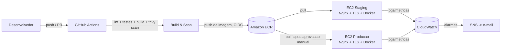

# Lacrei DevOps Challenge

Pipeline de deploy seguro para uma API Node.js fictícia (rota `/status`), com ambientes de **staging** e **produção** na AWS, containerizada com Docker e implantada via GitHub Actions.

## Sumário

- [Arquitetura](#arquitetura)
- [Aplicação](#aplicação)
- [Setup dos ambientes](#setup-dos-ambientes)
- [Fluxo de CI/CD](#fluxo-de-cicd)
- [Segurança](#segurança)
- [Observabilidade](#observabilidade)
- [Rollback](#rollback)
- [Erros encontrados e decisões técnicas](#erros-encontrados-e-decisões-técnicas)
- [Bônus: integração com Asaas](#bônus-integração-com-asaas)

## Arquitetura



- **Staging** e **Produção** são duas instâncias EC2 (Amazon Linux 2023) separadas, cada uma rodando o container Docker atrás de um Nginx com TLS (Let's Encrypt).
- A imagem é construída uma única vez no pipeline e promovida (mesma tag de imagem) de staging para produção — evita o problema de "funcionou em staging, quebrou em produção" por builds diferentes.
- Acesso administrativo via **AWS SSM Session Manager** (sem SSH exposto publicamente).

## Aplicação

API Node.js (Express) com:

- `GET /status` — health check (status, ambiente, versão, uptime).
- `GET /` — mensagem de boas-vindas.
- Logs estruturados em JSON (nível, rota, status, duração).
- `helmet` para cabeçalhos de segurança e `cors` restrito por variável de ambiente.

Rodar localmente:

```bash
npm install
npm test
npm start
# outra aba:
curl http://localhost:3000/status
```

Com Docker:

```bash
docker compose up --build
curl http://localhost:3000/status
```

> **Nota:** este código foi preparado em uma máquina sem Docker Desktop instalado, então o build da imagem foi validado apenas via pipeline (job `build-and-scan` do GitHub Actions), não localmente. A aplicação em si foi validada rodando diretamente com Node.js (testes automatizados + chamada real à rota `/status`).

## Setup dos ambientes

### Pré-requisitos

- Conta AWS com permissão para criar VPC, EC2, IAM, ECR, CloudWatch, SNS.
- Terraform >= 1.6.
- Repositório no GitHub (público, conforme exigido pelo desafio).
- Um domínio (para emitir certificado TLS válido) — pode ser um subdomínio gratuito para o teste.
- Par de chaves EC2 já criado na conta AWS (`aws ec2 create-key-pair`), apenas para acesso emergencial.

### 1. Provisionar a infraestrutura

```bash
cd terraform
cp terraform.tfvars.example terraform.tfvars
# edite terraform.tfvars com seus valores reais (região, domínio, CIDR do seu IP, etc.)

terraform init
terraform plan
terraform apply
```

Saídas relevantes: `ecr_repository_url`, `github_actions_role_arn`, `staging_public_ip`, `production_public_ip`.

### 2. Apontar DNS e emitir certificados TLS

Aponte `staging.SEU_DOMINIO` e `SEU_DOMINIO` para os respectivos Elastic IPs retornados pelo Terraform. Depois, em cada instância (via SSM Session Manager, **não SSH**):

```bash
aws ssm start-session --target <instance-id>
sudo certbot --nginx -d staging.SEU_DOMINIO --non-interactive --agree-tos -m seu-email@exemplo.com --redirect
```

### 3. Configurar o repositório GitHub

**Settings → Secrets and variables → Actions → Secrets:**

| Secret | Valor |
|---|---|
| `AWS_GITHUB_ACTIONS_ROLE_ARN` | saída `github_actions_role_arn` do Terraform |
| `STAGING_INSTANCE_ID` | saída `staging_public_ip` → busque o `instance-id` correspondente (`aws ec2 describe-instances`) |
| `PRODUCTION_INSTANCE_ID` | idem, para produção |

**Settings → Secrets and variables → Actions → Variables:**

| Variable | Valor |
|---|---|
| `APP_DOMAIN` | seu domínio, ex: `exemplo.com.br` |
| `DEPLOY_ENABLED` | `true` depois que a infraestrutura AWS estiver provisionada. Sem ela, o pipeline roda só lint, testes, build, scan e smoke test, sem tentar push/deploy |

**Settings → Environments:**

- Crie o ambiente `staging` (sem restrições).
- Crie o ambiente `production` com **Required reviewers** habilitado — isso implementa a exigência de "validação antes do deploy" em produção.

### 4. Primeiro deploy

Faça push na branch `main`. O pipeline builda, testa, escaneia, publica no ECR e implanta automaticamente em staging; produção aguarda aprovação manual no próprio GitHub Actions.

## Fluxo de CI/CD

Workflow principal: [`.github/workflows/ci-cd.yml`](.github/workflows/ci-cd.yml)

1. **lint-and-test** — `npm run lint` + `npm test` (Jest + Supertest).
2. **build-and-scan** — build da imagem Docker, scan de vulnerabilidades com Trivy (bloqueia em CRITICAL/HIGH), smoke test funcional do container (`/status` precisa responder 200 antes de seguir).
3. **push-image** *(só em push na `main`)* — autentica na AWS via OIDC (sem chaves estáticas), builda novamente com a tag do commit e publica no ECR.
4. **deploy-staging** — dispara `deploy.sh` na instância de staging via SSM, roda smoke test contra a URL pública.
5. **deploy-production** — mesma lógica, mas o ambiente `production` do GitHub exige aprovação manual de um reviewer antes de rodar.

Workflow de rollback: [`.github/workflows/rollback.yml`](.github/workflows/rollback.yml) — disparo manual (`workflow_dispatch`), escolhendo ambiente e tag da imagem.

## Segurança

Checklist completo em [`docs/security-checklist.md`](docs/security-checklist.md). Resumo:

- Autenticação AWS via **OIDC** (sem access keys de longa duração armazenadas no GitHub).
- IAM com menor privilégio (roles distintas para EC2 e para o pipeline, cada uma só com as permissões que usa).
- Administração das instâncias via **SSM Session Manager**; SSH restrito a um único CIDR e usado apenas como contingência.
- IMDSv2 obrigatório, volumes EBS criptografados.
- HTTPS/TLS via Let's Encrypt + Nginx.
- CORS restrito por variável de ambiente, `helmet` para cabeçalhos HTTP.
- Scan de vulnerabilidades da imagem (Trivy no pipeline + scan automático do ECR).
- Tags de imagem imutáveis no ECR.
- Deploy em produção com aprovação manual obrigatória.

## Observabilidade

- **Logs da aplicação**: formato JSON estruturado, coletados pelo driver `awslogs` do Docker e enviados para o CloudWatch Logs (`/lacrei-devops-challenge/<ambiente>/app`).
- **Logs de deploy**: cada execução do GitHub Actions fica registrada com logs completos de cada step (build, scan, deploy, smoke test).
- **Métricas de infraestrutura**: CloudWatch Agent instalado via `user_data` coleta uso de memória e disco de cada instância.
- **Alarmes**: CloudWatch Alarms para falha de status check da instância e para volume de erros da aplicação (`level=error`), notificando via **SNS → e-mail** (`terraform/monitoring.tf`).

## Rollback

Estratégia: como cada imagem publicada no ECR é **imutável** e versionada pelo SHA do commit, reverter significa apenas reimplantar uma tag anterior — não é necessário rebuild.

**Opção 1 — workflow do GitHub Actions (recomendado):**

Actions → `Rollback manual` → Run workflow → escolher `environment` e `image_tag` (SHA do commit desejado, visível no histórico de commits ou nas tags do ECR).

**Opção 2 — script local:**

```bash
./scripts/rollback.sh production a1b2c3d
```

Ambos os caminhos verificam que a imagem existe no ECR antes de aplicar, disparam o mesmo `deploy.sh` via SSM (troca o container em execução, sem downtime perceptível pois o `docker run` novo substitui o antigo) e rodam um smoke test em `/status` após o rollback.

**Critério para acionar rollback:** falha no smoke test pós-deploy, aumento do alarme `app-errors` no CloudWatch, ou reporte manual de indisponibilidade.

## Erros encontrados e decisões técnicas

- **Docker não disponível no ambiente onde este projeto foi preparado.** A aplicação foi validada rodando diretamente com Node.js (testes automatizados passando + chamada real a `/status`); o build e o smoke test do container ficam garantidos pelo job `build-and-scan` do pipeline, que roda em runner com Docker disponível.
- **EC2 em vez de ECS Fargate:** optamos por EC2 simples para manter a infraestrutura fácil de entender e depurar dentro do prazo do desafio, mantendo boas práticas (IMDSv2, SSM, IAM restrito) em vez de ir direto para uma arquitetura mais complexa (VPC multi-AZ, ALB, task definitions) que agregaria custo de setup sem benefício claro neste escopo.
- **SSM em vez de SSH como via principal:** elimina a necessidade de manter a porta 22 aberta amplamente; SSH continua disponível, mas restrito a um único CIDR, como contingência.
- **Deploy via SSM `send-command` em vez de um agente próprio ou CodeDeploy:** mantém o pipeline simples, sem infraestrutura adicional (bucket, agente CodeDeploy), aproveitando um recurso que já é necessário para administração das instâncias.
- **Scan do Trivy barrando o build (out/2026):** o gate cumpriu o papel. Ele bloqueou dependências com CVEs críticas e altas (`proxy-addr` e `body-parser`, vindas do Express) e a imagem base `node:20-alpine`, que chegou ao fim de suporte. A correção foi atualizar as dependências no `package-lock.json`, migrar para `node:24-alpine` (LTS), aplicar `apk upgrade` e remover npm/npx/corepack da imagem final. O scan passou a ignorar só as CVEs que ainda não têm correção publicada (`ignore-unfixed`).
- **Tags de imagem imutáveis no ECR:** evita que um rollback "silencioso" aconteça por sobrescrita acidental da mesma tag; cada commit gera uma imagem própria e rastreável.
- **Integração com Asaas tratada como proposta/mock (bônus):** ver seção abaixo — implementar contra a API real exigiria conta e credenciais reais de terceiros, fora do escopo de infraestrutura avaliado.

## Bônus: integração com Asaas

Proposta de arquitetura (split de pagamento entre plataforma e prestadores), com mock de requisições: [`docs/asaas-integration.md`](docs/asaas-integration.md).
