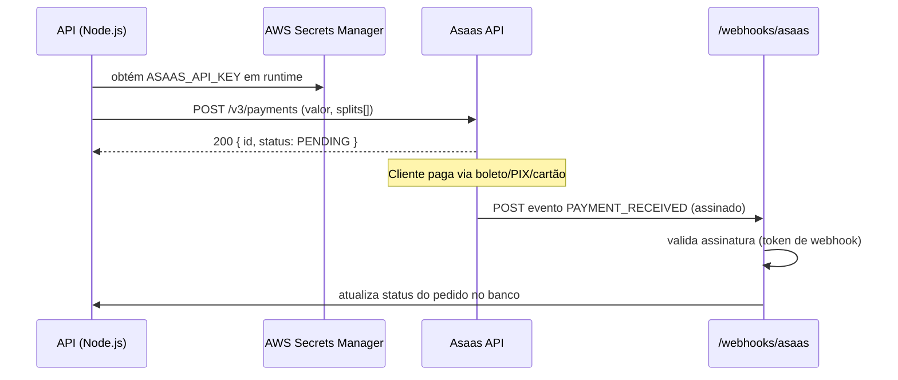

# Proposta de Integração com Asaas (split de pagamento)

> Item bônus do desafio. Proposta arquitetural + mock de requisições — **não implementada como código de produção**, pois exigiria uma conta ativa na Asaas e credenciais reais de API.

## Objetivo

Permitir que a aplicação (hoje só expõe `/status`) processe cobranças e faça **split de pagamento** entre a plataforma (Lacrei Saúde) e prestadores de serviço (ex: profissionais de saúde cadastrados), usando a [API da Asaas](https://docs.asaas.com/).

## Arquitetura proposta



## Componentes novos necessários

1. **Novo serviço/rota `payments`**
   - `POST /payments` — cria cobrança na Asaas com `split` definindo o percentual/valor fixo destinado a cada prestador (`walletId` de cada um).
   - `GET /payments/:id` — consulta status.
   - `POST /webhooks/asaas` — recebe notificações de mudança de status (pago, estornado, etc). Deve validar o `asaas-access-token` do cabeçalho contra um segredo configurado no painel Asaas.

2. **Gerenciamento de credenciais**
   - `ASAAS_API_KEY` e `ASAAS_WEBHOOK_TOKEN` armazenados no **AWS Secrets Manager**, nunca em variável de ambiente estática no GitHub Secrets (chave de pagamento é sensível e pode ser rotacionada sem redeploy).
   - A aplicação busca o segredo em runtime (SDK `@aws-sdk/client-secrets-manager`), com cache em memória e TTL curto.

3. **Split de pagamento**
   - Cada prestador de serviço precisa de um `walletId` Asaas (obtido no cadastro de subconta/carteira).
   - Corpo da requisição de cobrança inclui:
     ```json
     {
       "customer": "cus_000001",
       "billingType": "PIX",
       "value": 150.00,
       "dueDate": "2026-07-20",
       "split": [
         { "walletId": "wallet-prestador-123", "percentualValue": 85 },
         { "walletId": "wallet-plataforma-lacrei", "percentualValue": 15 }
       ]
     }
     ```

4. **Idempotência e confiabilidade**
   - Persistir cada cobrança criada com uma `externalReference` própria para evitar duplicidade em retries.
   - Fila (SQS) entre o webhook e o processamento do evento, para não bloquear a resposta HTTP à Asaas e permitir novas tentativas em caso de falha no processamento interno.

## Mock de requisição (Postman/cURL) — ambiente sandbox

```bash
curl -X POST https://sandbox.asaas.com/api/v3/payments \
  -H "access_token: $ASAAS_SANDBOX_API_KEY" \
  -H "Content-Type: application/json" \
  -d '{
        "customer": "cus_000005219653",
        "billingType": "PIX",
        "value": 100.00,
        "dueDate": "2026-07-25",
        "split": [
          { "walletId": "22e49670-27e4-4579-a4c1-205c8a40497c", "percentualValue": 90 }
        ]
      }'
```

## Segurança específica desta integração

- Validar assinatura/token do webhook antes de processar qualquer payload.
- Nunca logar números de cartão, CPF/CNPJ completos ou o `access_token` da Asaas (mascarar em logs).
- Escopo de IAM: se usar Secrets Manager, a role da EC2 só pode dar `secretsmanager:GetSecretValue` no ARN específico do segredo Asaas — nunca `*`.
- Rate limiting na rota `/webhooks/asaas` para mitigar abuso.

## Por que não foi implementado como código real

O desafio pede "mock ou arquitetura" para este item bônus. Implementar contra a API real da Asaas exigiria criar uma conta na plataforma e gerar chaves de API reais — ações que envolvem dados financeiros e cadastro em serviço de terceiros, fora do escopo de infraestrutura que este desafio avalia. A proposta acima é suficiente para demonstrar o desenho da integração e pode ser implementada incrementalmente a partir da rota `/status` já existente.
